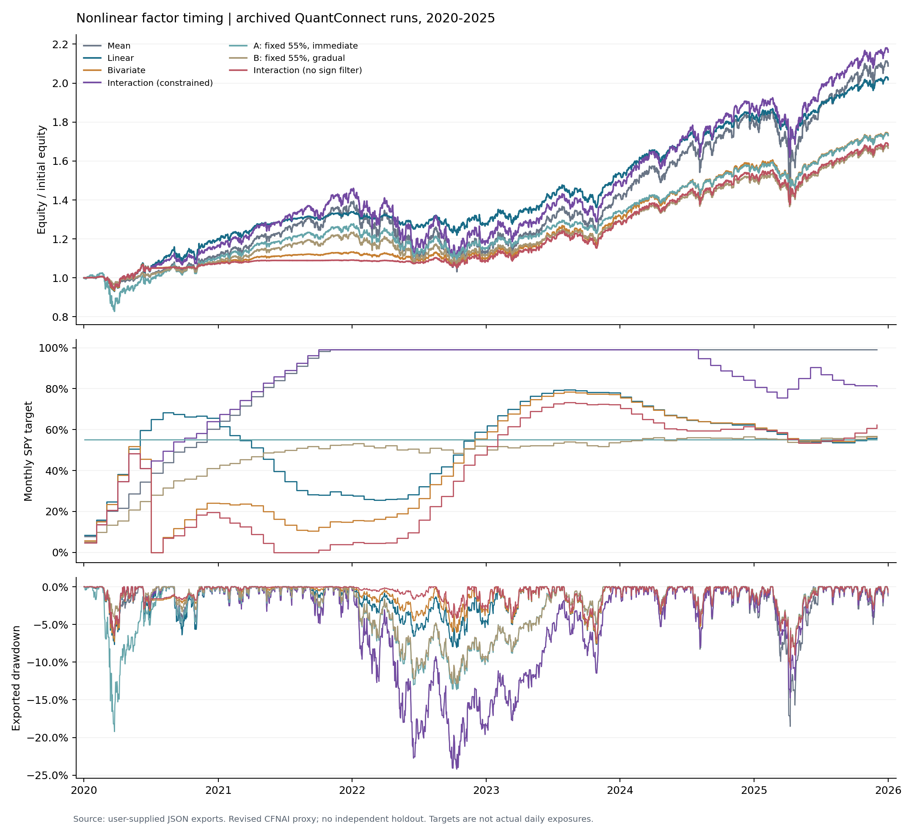

# Nonlinear Factor Timing

[中文说明](README_zh.md) · [Results](results/summary.md) · [Experiment log](docs/EXPERIMENT_LOG_zh.md)

A QuantConnect implementation of state-dependent return prediction and dynamic allocation,
using SPY dividend yield and CFNAI as a market-timing proxy, with BIL as the residual asset.
Based on Huaan Securities' *Factor Timing in a Nonlinear World* report (2026-10-21).
This is a documented proxy adaptation, not a replication of the original paper's datasets or tables.

The archive compares historical-mean, valuation-only, additive macro and interaction forecasts;
then adds fixed-allocation controls and an economic-sign-filter ablation. All existing runs,
including weaker results, are retained. The project stops after the ablation experiment.

## Archived results

2020-01-01 to 2025-12-31; initial capital USD 1,000,000. Metrics below are copied from the
original platform exports. Average targets are calculated from 72 monthly allocation points.

| Run | Total return | CAGR | Sharpe | Max drawdown | Avg SPY target |
|---|---:|---:|---:|---:|---:|
| Mean | 108.782% | 13.043% | 0.527 | 26.0% | 85.98% |
| Linear | 101.758% | 12.400% | 0.740 | 11.4% | 54.01% |
| Bivariate | 73.406% | 9.601% | 0.558 | 11.6% | 44.15% |
| Interaction, constrained | 115.912% | 13.676% | 0.577 | 26.0% | 83.68% |
| A: fixed 55%, immediate | 73.080% | 9.566% | 0.435 | 19.2% | 55.00% |
| B: fixed 55%, gradual | 66.597% | 8.872% | 0.482 | 13.9% | 47.99% |
| C: constrained interaction repeat | 115.912% | 13.676% | 0.577 | 26.0% | 83.68% |
| Interaction, no sign filter | 68.023% | 9.027% | 0.543 | 11.5% | 38.43% |



The linear model has the best reported Sharpe in this sample, but its one-step forecast OOS R²
is -0.7606%. Constrained interaction falls back to the historical mean in 52/72 fits and touches
the 99% allocation cap in 34/72 rebalances. Removing the sign filter lowers exposure and returns;
its forecast OOS R² falls to -20.7547%. These runs do not establish robust incremental predictive
value from the interaction term. The 55% controls were chosen after examining linear exposure,
so the comparison is exploratory, not an untouched holdout test.

## Reproduce the archived analysis offline

Python 3.12 was used for packaging and local verification. From the extracted repository root:

```bash
python -m venv .venv
# macOS/Linux: source .venv/bin/activate
# Windows PowerShell: .venv\Scripts\Activate.ps1
python -m pip install -r requirements-analysis.txt
python tests.py
python scripts/summarize_results.py --plots
python scripts/verify_archive.py
```

The summary script reads only the original exports; it does not rerun the trading algorithm.
The checked-in figure is a visual summary. Exact summary CSVs and parameter snapshots are
also included. `requirements-reproduction.txt` records the direct local package versions.
For hash verification of the pristine delivered files, run the verification command before
regenerating figures; PNG metadata may vary across runtime versions.

## Run the trading strategy

Use QuantConnect/LEAN rather than `python main.py`. Add **main.py** and **timing_core.py**
to the same algorithm project, and supply the two CSVs in `examples/` via Object Store or
direct HTTPS CSV URLs. Select an archived configuration from `configs/parameters/`.
Those JSON files document platform Parameters; main.py does not read them automatically.
See [step-by-step instructions](docs/QUANTCONNECT_RUN_zh.md).

The source default remains `model=interaction, economic_constraints=true`; the last ablation
is available explicitly and was not silently promoted to the default. The default training
window is 240 completed monthly pairs, gamma=3, lambda=300 and max_weight=0.99.

## Repository map

| Location | Contents |
|---|---|
| main.py / timing_core.py | Readable QuantConnect adapter and numerical model |
| paper_research.py | Market/HML/PC1/joint research interfaces; no fabricated factor results |
| tests.py | 26 local numerical, timing, PCA, loader and allocation tests |
| examples/ | Two revised macro snapshots, source metadata and header-only research schemas |
| configs/ | Exact exported parameter sets and experiment registry |
| results/raw/ | Nine unmodified JSON downloads, including the identical duplicate |
| results/derived/ | Equity closes, monthly targets, drawdown and order CSVs |
| results/evidence/ | Original log screenshots; transcription is separately labeled |
| docs/ | Method, experiment history, data boundaries, execution and upload instructions |
| references/ | User-supplied source report and attribution |
| archive/ | Previous source bundle and validation/environment records |

## Data and reproduction boundaries

The supplied CFNAI and TB3MS data are **revised history with an assumed two-month availability
delay**, not point-in-time vintages. The delay does not remove revision bias. Full SPY/BIL
price history, original PMI vintages and the paper's 50-anomaly panels are not included.
Schema files contain headers only. HML/PC1 research code is present, but those empirical
experiments have not been completed with original data.

All nine JSON downloads represent eight cloud runs; one Snake file is a byte-identical
download duplicate, and C repeats the original interaction configuration. The latest source
is preserved, but per-run cloud source revisions and monthly forecast records are unavailable.
Local tests mock QC services and do not constitute a new cloud/LEAN integration test.
See [full data inventory and definitions](docs/DATA_AND_REPRODUCIBILITY_zh.md).

No remote repository was created or pushed during this archival step. See
[upload instructions](docs/GITHUB_UPLOAD_zh.md) and [license/attribution notice](LICENSE_NOTICE.md).
